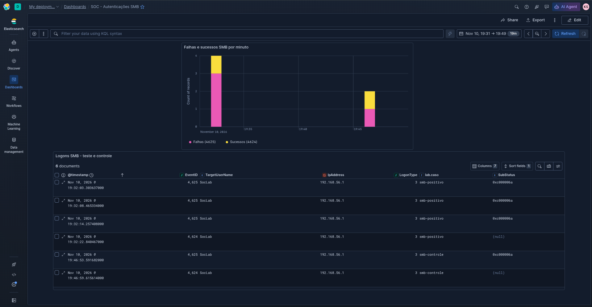

# SOC Windows Logon Lab

Montei este laboratório para investigar falhas de senha seguidas de um logon bem-sucedido no Windows. Usei o Kali Linux, uma VM Windows e a conta de teste `SocLab`, com autenticações locais e acessos via SMB.

Comecei pelas consultas no PowerShell e pela análise dos eventos Security e Sysmon. Depois, escrevi uma proposta de correlação em Sigma e levei os eventos SMB para o Elastic Cloud, onde montei um dashboard e executei uma consulta EQL.

## O que foi testado

A regra conta falhas de senha nos 60 segundos anteriores a um sucesso, considerando o mesmo computador, domínio, usuário, tipo de logon e endereço de origem. O limite escolhido para o laboratório foi de três falhas.

| Caso | Tipo de logon | Origem | Falhas na janela | Resultado da regra |
|---|---:|---|---:|---|
| Local: três falhas e sucesso | 2 | `::1` | 3 | `True` |
| Local: uma falha e sucesso | 2 | `::1` | 1 | `False` |
| SMB: três falhas e sucesso | 3 | `192.168.56.1` | 3 | `True` |
| SMB: uma falha e sucesso | 3 | `192.168.56.1` | 1 | `False` |

Os quatro casos foram conferidos por consultas interativas. Também repeti a análise dos dois casos SMB com o script `analisar-logons.ps1`, usando os EVTX exportados, e obtive os mesmos resultados.

Na etapa local, relacionei o `TargetLogonId` do Security 4624 ao `LogonId` do Sysmon 1. Isso permitiu associar a sessão de `SocLab` à criação de `cmd.exe`, com `runas.exe` como processo pai.

## Ambiente e escolha da arquitetura

- Notebook com 12 GB de RAM e Kali Linux como hospedeiro e cliente SMB.
- VM Windows 11 Enterprise Evaluation no VirtualBox, com 6 GB de RAM e duas CPUs virtuais.
- Rede host-only: Kali `192.168.56.1` e Windows `192.168.56.101`.
- Conta local `SocLab` e compartilhamento de leitura `LabSOC`.
- Windows Security, Sysmon, PowerShell, smbclient, Python, pySigma e Elastic Cloud.

Como a VM já usava metade da RAM do notebook, optei por exportar os eventos e trabalhar com os arquivos salvos. Isso permitiu continuar a análise no Kali sem manter a VM ligada e usar o Elastic Cloud para as consultas e visualizações.

A ingestão no Elastic foi manual, a partir de um NDJSON gerado dos EVTX. Não configurei coleta contínua por agente nem uma regra de alerta agendada.

## Dashboard no Elastic



O dashboard **SOC - Autenticações SMB** usa o índice `lab-soc-smb`, com seis eventos: três falhas e um sucesso no caso positivo, mais uma falha e um sucesso no controle. O gráfico mostra as contagens por minuto; a tabela permite conferir a ordem dos eventos e seus campos.

Também executei uma consulta EQL para procurar três falhas seguidas de sucesso na mesma sequência, com `maxspan=60s`. Ela retornou **uma sequência**, formada pelos registros `14182`, `14183`, `14184` e `14185`, todos do caso positivo. O controle não apareceu no resultado.

A consulta completa, os horários e os critérios de correlação estão no [relatório técnico](docs/relatorio.md#consulta-eql-e-resultado).

## Regra em PowerShell e proposta em Sigma

Para cada sucesso **4624**, o script conta falhas **4625** com `SubStatus = 0xc000006a` — senha incorreta — no intervalo **[sucesso − 60 segundos, sucesso)**. As falhas precisam ter os mesmos valores de computador, domínio, usuário, tipo de logon e origem. Com três ou mais, o resultado é `Alerta = True`.

O arquivo [detect_brute_force.yml](rules/detect_brute_force.yml) organiza a proposta em quatro blocos: seleção de falhas, seleção de sucessos, contagem de falhas e correlação temporal ordenada. Os quatro blocos foram carregados pelo pySigma e suas referências foram resolvidas sem erro.

Essa validação cobre a estrutura do arquivo. A versão Sigma continua experimental: suas duas correlações de 60 segundos não garantem, por si só, a mesma janela única usada pelo PowerShell. A consulta EQL foi escrita e executada separadamente; não foi resultado de uma conversão validada desse YAML.

## Relação com MITRE ATT&CK

| Comportamento estudado | Referência |
|---|---|
| Tentativas repetidas com senha incorreta | [T1110 - Brute Force / T1110.001 — Password Guessing](https://attack.mitre.org/techniques/T1110/001/) |
| Autenticação com a conta local de teste | [T1078 - Valid Accounts / T1078.003 — Local Accounts](https://attack.mitre.org/techniques/T1078/003/) |
| Criação local de `cmd.exe`, observada no Sysmon | [T1059.003 - Windows Command Shell](https://attack.mitre.org/techniques/T1059/003/), na tática Execution |

O mapeamento relaciona os comportamentos do exercício às técnicas. As tentativas foram controladas e a senha correta era conhecida; os eventos não comprovam roubo de credenciais ou comprometimento. A execução de `cmd.exe` pertence à etapa local com `runas`.

## Arquivos do projeto

- [Script PowerShell](scripts/analisar-logons.ps1): análise dos EVTX Security.
- [Regra Sigma experimental](rules/detect_brute_force.yml): seleções e correlações.
- [Relatório técnico](docs/relatorio.md): procedimentos, evidências, consulta EQL e limites da validação.
- [Imagem do dashboard](docs/dashboard-elastic.png).
- [Exportação do dashboard](dashboards/): configuração salva do Kibana. Os dados do índice precisam ser importados separadamente.

## Como executar o script

Use o PowerShell 5.1 ou posterior no Windows. Os EVTX precisam estar disponíveis localmente; os arquivos brutos não estão no repositório.

A partir da raiz do projeto, ajuste os caminhos se necessário:

```powershell
.\scripts\analisar-logons.ps1 -ArquivoEVTX 'C:\Users\Ka\Lab\Evidencias\03-smb\Security-SMB.evtx' | Format-List
.\scripts\analisar-logons.ps1 -ArquivoEVTX 'C:\Users\Ka\Lab\Evidencias\04-smb-controle\Security-SMB-controle.evtx' | Format-List
```

Para analisar outra conta, acrescente `-Usuario 'NomeDaConta'`. O script retorna um objeto por sucesso encontrado, incluindo os IDs dos registros usados na correlação. A leitura não altera os EVTX.

Se a política de execução bloquear o script criado localmente, o ajuste utilizado no laboratório foi limitado à sessão:

```powershell
Set-ExecutionPolicy -Scope Process -ExecutionPolicy RemoteSigned -Force
```

## Evidências e limites

Os EVTX, resultados CSV e manifestos SHA-256 foram preservados nas pastas `01-logon`, `02-controle`, `03-smb` e `04-smb-controle`. O pacote transferido para o Kali teve seu SHA-256 comparado com o valor calculado no Windows. Os arquivos brutos permanecem no acervo local.

O laboratório cobre quatro casos, uma conta e um computador Windows. Não mede taxas de falsos positivos ou negativos em produção. Uma sequência que atende à regra precisa de contexto antes de ser tratada como incidente.

O limite de três falhas em 60 segundos foi escolhido para o exercício. Tentativas mais espaçadas, como em um ataque *low-and-slow*, podem ficar fora dessa janela. Em outro ambiente, seria necessário estudar o comportamento habitual de usuários e serviços e testar outros limites.

A análise depende dos eventos preservados e exige um sucesso posterior. O acesso SMB não comprova execução remota de processos. O Elastic foi usado para análise histórica, dashboard e consulta manual; não houve monitoramento contínuo ou resposta automática.

As referências e os detalhes das validações estão no [relatório técnico](docs/relatorio.md).
