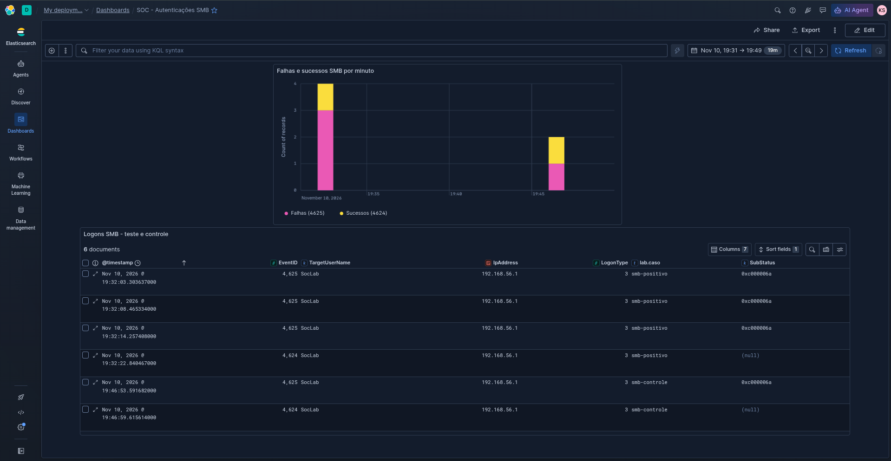

# Laboratório SOC — correlação de falhas de logon locais e via SMB

**Ambiente:** Kali Linux e Windows 11 Enterprise Evaluation no VirtualBox.  
**Fontes:** Windows Security e Microsoft-Windows-Sysmon/Operational.  
**Análise:** Visualizador de Eventos, PowerShell, arquivos EVTX, pySigma e Elastic Cloud.

## Objetivo e resultados

O exercício investigou falhas de senha seguidas de autenticação bem-sucedida em dois contextos: execução local com `runas` e acesso via SMB a partir do Kali. Em cada contexto, comparei três falhas seguidas de sucesso com um controle de uma falha seguida de sucesso.

| Caso | Tipo de logon | Origem | Falhas nos 60 s anteriores ao sucesso | Resultado da regra |
|---|---:|---|---:|---|
| Local — três falhas e sucesso | 2 | `::1` | 3 | `True` |
| Local — controle com uma falha e sucesso | 2 | `::1` | 1 | `False` |
| SMB — três falhas e sucesso | 3 | `192.168.56.1` | 3 | `True` |
| SMB — controle com uma falha e sucesso | 3 | `192.168.56.1` | 1 | `False` |

Os quatro casos foram produzidos intencionalmente e conferidos por consultas interativas. O script reutilizável reproduziu os dois resultados SMB a partir dos EVTX exportados. Na etapa local, também relacionei a sessão de `SocLab` à criação de `cmd.exe` usando o Sysmon.

Depois, importei seis eventos SMB no Elastic Cloud. A consulta EQL retornou uma sequência do caso positivo e nenhuma do controle. O arquivo Sigma teve sua estrutura e suas referências verificadas pelo pySigma; sua execução como regra convertida não foi validada.

## Ambiente e decisão de arquitetura

O notebook possui 12 GB de RAM e usa Kali Linux como sistema hospedeiro. A VM `Windows-SOC` recebeu 6 GB de RAM e duas CPUs virtuais. O computador Windows é `DESKTOP-EJJMRGB`, com a conta principal `Ka` e a conta local de teste `SocLab`.

Para trabalhar dentro desse limite de memória, separei a geração dos eventos da análise posterior: exportei recortes EVTX, preservei os arquivos e passei a analisá-los offline. Assim, a VM não precisava permanecer ligada durante a leitura dos arquivos no Kali e o uso do Elastic Cloud pelo navegador.

O PowerShell foi usado para consultar os logs e repetir a correlação no Windows. No Kali, Python foi usado para ler os EVTX SMB e gerar o NDJSON importado manualmente no Elastic. O dashboard e a consulta EQL trabalham com esse conjunto histórico.

Uma evolução para monitoramento contínuo seria coletar os canais Windows com um agente, como o Wazuh, e encaminhá-los à plataforma central. Essa arquitetura precisaria de regras, retenção e notificações próprias. A coleta contínua por agente não fez parte deste exercício.

### Rede e compartilhamento

Na etapa SMB, o adaptador da VM foi conectado à rede host-only `vboxnet0`:

| Componente | Endereço e função |
|---|---|
| Kali / `vboxnet0` | `192.168.56.1/24`; cliente SMB |
| Windows-SOC | `192.168.56.101/24`; servidor SMB, sem gateway padrão nesse adaptador |
| DHCP host-only | Servidor `192.168.56.100`, faixa `192.168.56.101–254` |
| Compartilhamento | `LabSOC`, diretório `C:\LabSMB`, arquivo `teste.txt` |

O compartilhamento concedeu leitura a `SocLab`, com permissão NTFS de leitura e execução. A regra de firewall `LabSOC-SMB-Kali` foi criada para permitir TCP/445 no endereço `192.168.56.101`, tendo `192.168.56.1` como origem. Essa descrição se refere à regra criada, não a uma auditoria de todas as regras do firewall. Os IPs são os observados durante o teste; a VM recebeu seu endereço por DHCP.

## Regra de correlação

Para cada sucesso **4624**, a consulta conta falhas **4625** com `SubStatus = 0xc000006a` — senha incorreta — no intervalo **[sucesso − 60 segundos, sucesso)**. A falha precisa corresponder ao sucesso nos campos:

- `Computer`: computador.
- `TargetDomainName` e `TargetUserName`: domínio e usuário.
- `LogonType`: tipo de logon.
- `IpAddress`: endereço de origem.

O resultado é `Alerta = True` quando a contagem é maior ou igual a três. Esse é o critério aplicado nas consultas PowerShell e no script.

Os 60 segundos e as três falhas foram escolhidos para tornar o teste reproduzível. Não são apresentados como valores recomendados para qualquer ambiente.

## Etapa local — 08/11/2026

A conta `Ka` solicitou a execução de `cmd.exe` com as credenciais de `SocLab`:

```text
runas /user:DESKTOP-EJJMRGB\SocLab cmd.exe
```

No caso com três falhas, os eventos registraram tipo de logon `2` — interativo —, origem `::1` — loopback —, substatus `0xC000006A` e status geral `0xC000006D`.

### Linha do tempo

Horários locais de Brasília, UTC−3, em 08/11/2026. Os XMLs registram os horários em UTC.

| Hora local | Fonte / evento | EventRecordID | Observação |
|---|---|---:|---|
| 16:49:30 | Security / 4625 | 14004 | Primeira falha de senha para `SocLab` |
| 16:49:33 | Security / 4625 | 14005 | Segunda falha |
| 16:49:36 | Security / 4625 | 14006 | Terceira falha |
| 16:49:44 | Security / 4648 | 14007 | Tentativa com credenciais explícitas |
| 16:49:44 | Security / 4624 | 14008 | Criação da sessão de `SocLab` |
| 16:49:44 | Sysmon / 1 | 1506 | Criação de `cmd.exe` como `SocLab` |

Da primeira falha ao sucesso transcorreram aproximadamente **13,93 segundos**, calculados pelos timestamps dos XMLs. O sucesso foi registrado às `16:49:44.043`, no horário local. O evento 4648 indica a tentativa com credenciais explícitas; a confirmação da sessão vem do 4624.

### Associação entre sessão e processo

O Security 4624 contém `TargetLogonId = 0x14bfc2d`. O Sysmon 1 apresenta o mesmo valor em `LogonId`, no mesmo computador e para a mesma conta.

| Campo do Sysmon | Valor observado |
|---|---|
| Processo | `C:\Windows\System32\cmd.exe` |
| PID | `10196` |
| Usuário | `DESKTOP-EJJMRGB\SocLab` |
| LogonId | `0x14bfc2d` |
| ProcessGuid | `{eadcf747-d258-6af0-f603-000000000600}` |
| Processo pai | `C:\Windows\System32\runas.exe` |
| PID do pai | `8644` |
| Usuário do pai | `DESKTOP-EJJMRGB\Ka` |
| Linha de comando do pai | `runas.exe /user:DESKTOP-EJJMRGB\SocLab cmd.exe` |
| Integridade | `Medium` |

A integridade `Medium` é coerente com `Token Elevado: Não` no 4624. A associação considera computador, conta, identificador de sessão e proximidade temporal. O identificador de sessão precisa ser interpretado no contexto do host e do período analisado.

### Controle local

A coleta do controle foi delimitada entre **19:42:12.779 e 19:43:09.596**, no horário local de 08/11/2026. Foi conferida a presença de um 4625 seguido de um 4624 para `SocLab`. Com os mesmos critérios, a consulta retornou **uma falha e `Alerta = False`**.

## Etapa SMB — 10/11/2026

A conexão ao compartilhamento foi iniciada no Kali com:

```bash
smbclient //192.168.56.101/LabSOC -p 445 -W DESKTOP-EJJMRGB -U SocLab
```

A senha foi informada no prompt interativo. Uma conexão inicial com a senha correta permitiu listar `teste.txt` com `ls` e encerrar com `quit`.

### Acesso inicial

| Campo do Security 4624 | Valor observado |
|---|---|
| Hora local | `2026-11-10 19:27:18` |
| EventRecordID | `14175` |
| Conta | `DESKTOP-EJJMRGB\SocLab` |
| Tipo de logon | `3` — rede |
| Origem | `192.168.56.1` |
| Estação de trabalho | `KALI-KAH` |
| Pacote de autenticação | `NTLM` |
| Nome do pacote NTLM | `NTLM V2` |
| TargetLogonId | `0x271012` |

O tipo 3, o endereço de origem e o uso do cliente SMB sustentam a identificação desse acesso pela rede. Esse evento foi usado como referência para separar as tentativas seguintes.

### Três falhas e sucesso

Foram feitas três tentativas com senha incorreta e, depois, uma com a senha correta. A consulta ao Security retornou:

```text
Conta     : DESKTOP-EJJMRGB\SocLab
Sucesso   : 2026-11-10 19:32:22.840
Origem    : 192.168.56.1
TipoLogon : 3
Sessao    : 0x33016c
Falhas60s : 3
Alerta    : True
```

A leitura posterior do EVTX no Kali confirmou a sequência abaixo. Todos os eventos têm conta `SocLab`, tipo de logon `3` e origem `192.168.56.1`.

| Horário UTC em 10/11/2026 | Evento | EventRecordID | SubStatus |
|---|---:|---:|---|
| 22:32:03.303637 | 4625 | 14182 | `0xc000006a` |
| 22:32:08.465334 | 4625 | 14183 | `0xc000006a` |
| 22:32:14.257408 | 4625 | 14184 | `0xc000006a` |
| 22:32:22.840467 | 4624 | 14185 | Não presente |

O intervalo entre a primeira falha e o sucesso foi de **19,536830 segundos**, dentro da janela do teste.

### Controle SMB

Em uma execução separada, foi feita uma tentativa com senha incorreta seguida de uma com a senha correta.

| Horário UTC em 10/11/2026 | Evento | EventRecordID | SubStatus |
|---|---:|---:|---|
| 22:46:53.591682 | 4625 | 14192 | `0xc000006a` |
| 22:46:59.615614 | 4624 | 14193 | Não presente |

A regra retornou **`Falhas60s = 1` e `Alerta = False`**. Os eventos e o resultado foram exportados separadamente do caso positivo.

Esta etapa trata de autenticação pela rede e acesso ao compartilhamento. O logon SMB não demonstra execução remota de `cmd.exe`; a associação com esse processo foi feita na etapa local com `runas`.

## Repetição com o script PowerShell

O [analisar-logons.ps1](../scripts/analisar-logons.ps1) lê o EVTX, interpreta os campos XML pelo nome e aplica a regra a cada sucesso 4624 da conta indicada. A conta padrão é `SocLab`. A saída inclui host, conta, horários local e UTC, IDs dos registros, origem, tipo de logon, sessão, contagem de falhas e resultado.

O script usa `Get-WinEvent` e requer PowerShell no Windows, versão 5.1 ou posterior. Ele lê os eventos Security 4624/4625 sem alterar o EVTX ou exportar arquivos automaticamente. A associação com Sysmon foi feita separadamente.

Com o script salvo na VM em `C:\Users\Ka\Lab`, executei:

```powershell
Set-Location 'C:\Users\Ka\Lab'

.\analisar-logons.ps1 -ArquivoEVTX '.\Evidencias\03-smb\Security-SMB.evtx' | Format-List

.\analisar-logons.ps1 -ArquivoEVTX '.\Evidencias\04-smb-controle\Security-SMB-controle.evtx' | Format-List
```

| Arquivo | Falhas60s | Alerta |
|---|---:|---|
| `Security-SMB.evtx` | 3 | `True` |
| `Security-SMB-controle.evtx` | 1 | `False` |

A política de execução bloqueou inicialmente a abertura do script. Para executar o arquivo criado localmente, usei o ajuste abaixo apenas na sessão PowerShell em uso:

```powershell
Set-ExecutionPolicy -Scope Process -ExecutionPolicy RemoteSigned -Force
```

Os dois comandos foram executados após esse ajuste. A validação do script reutilizável abrange os dois EVTX SMB; os resultados locais foram obtidos pelas consultas interativas anteriores.

## Proposta em Sigma

O arquivo [detect_brute_force.yml](../rules/detect_brute_force.yml) possui quatro documentos YAML:

| Bloco | Função |
|---|---|
| Falha de senha | Selecionar 4625 de `SocLab` com `SubStatus = 0xc000006a` |
| Logon bem-sucedido | Selecionar 4624 de `SocLab` |
| `event_count` | Contar três ou mais falhas em 60 segundos, agrupadas pelos campos da regra |
| `temporal_ordered` | Relacionar a contagem de falhas ao sucesso posterior |

O pySigma carregou os quatro blocos e resolveu as referências por UUID:

```text
OK: 4 blocos carregados.
Referencias entre as regras resolvidas.
```

Essa verificação confirma a leitura da estrutura e a resolução das referências. Não demonstra execução da correlação em um SIEM. O suporte depende do backend de conversão e dos recursos da plataforma de destino, como descreve a [especificação Sigma](https://sigmahq.io/sigma-specification/specification/sigma-correlation-rules-specification.html).

A proposta continua experimental. Há uma janela de 60 segundos na contagem e outra na correlação temporal; esse encadeamento não garante que todas as falhas estejam nos 60 segundos anteriores ao sucesso, como exige o PowerShell. A equivalência dessa versão precisa ser testada no backend escolhido. A consulta EQL a seguir foi escrita separadamente e não valida a conversão do arquivo Sigma.

## Análise offline no Elastic Cloud

### Preparação e ingestão

No Kali, os dois EVTX SMB foram lidos com `python-evtx`, e os XMLs foram processados com `defusedxml`. Foram selecionados os eventos 4624/4625 de `SocLab`, gerando o arquivo `logons-smb.ndjson` com seis documentos.

Os campos mantiveram os nomes do Windows, como `EventID`, `Computer`, `TargetUserName`, `LogonType` e `IpAddress`. O horário UTC foi incluído em `@timestamp`. Cada documento também recebeu `lab.caso`, `lab.arquivo` e `lab.evtx_sha256` para identificar o cenário e o EVTX de origem. Não foi feita uma normalização completa para ECS.

O NDJSON foi importado manualmente no índice `lab-soc-smb`, com uma data view de mesmo nome. A importação usou o arquivo convertido, e não o EVTX binário. O conjunto contém quatro eventos de `smb-positivo` e dois de `smb-controle`.

### Dashboard

O dashboard **SOC - Autenticações SMB** reúne:

- Um gráfico de barras empilhadas com contagem por minuto, separando falhas 4625 de sucessos 4624.
- Uma tabela com os seis eventos em ordem cronológica, exibindo horário, evento, conta, origem, tipo de logon, cenário e substatus.



Na imagem, o período selecionado é de **19:31 a 19:49 de 10/11/2026**, em UTC−3. Os dados de origem usam UTC. O primeiro grupo contém três falhas e um sucesso; o segundo, uma falha e um sucesso.

O gráfico apresenta contagens por minuto. A verificação da ordem e da janela de correlação foi feita pelas consultas e pelos timestamps dos eventos.

A configuração do dashboard foi exportada para a pasta [dashboards](../dashboards/). Essa exportação permite guardar os objetos do Kibana; ela não substitui os dados do índice.

### Consulta EQL e resultado

No Console do Kibana, executei a consulta abaixo sobre `lab-soc-smb`. O bloco usa a sintaxe do Console, incluindo a string de múltiplas linhas delimitada por três aspas.

```http
GET lab-soc-smb/_eql/search
{
  "timestamp_field": "@timestamp",
  "tiebreaker_field": "EventRecordID",
  "size": 10,
  "query": """
    sequence by Computer, TargetDomainName, TargetUserName, LogonType, IpAddress
    with maxspan=60s

      [any where
        EventID == 4625 and
        TargetUserName : "SocLab" and
        SubStatus : "0xc000006a"
      ] with runs=3

      [any where
        EventID == 4624 and
        TargetUserName : "SocLab"
      ]
  """
}
```

`sequence by` exige os mesmos valores nos campos de agrupamento. `with runs=3` repete o critério de falha três vezes, e `maxspan=60s` limita a duração da sequência desde seu primeiro evento. O último critério procura o sucesso. O uso de `any` permite consultar esses documentos sem um campo `event.category`.

A resposta retornou `hits.total.value = 1`, com `is_partial = false`, `is_running = false` e `timed_out = false`. A sequência contém:

| Posição | Evento | EventRecordID | Horário UTC em 10/11/2026 |
|---:|---:|---:|---|
| 1 | 4625 | 14182 | 22:32:03.303637 |
| 2 | 4625 | 14183 | 22:32:08.465334 |
| 3 | 4625 | 14184 | 22:32:14.257408 |
| 4 | 4624 | 14185 | 22:32:22.840467 |

As chaves de agrupamento foram computador e domínio `DESKTOP-EJJMRGB`, usuário `SocLab`, tipo de logon `3` e origem `192.168.56.1`. Todos os documentos retornados pertencem a `smb-positivo`. Os dois documentos do controle estavam no índice, mas não formaram uma sequência correspondente.

O resultado confirma o comportamento esperado nesses dois conjuntos SMB. Foi uma consulta manual sobre dados históricos: não houve criação de uma regra agendada no Elastic Security nem geração de uma notificação automática.

A consulta EQL retorna sequências, enquanto o PowerShell conta as falhas anteriores a cada sucesso. Os testes realizados não estabelecem equivalência para todos os casos, como eventos com timestamps iguais, ocorrências exatamente no limite de 60 segundos ou vários sucessos próximos.

## Mapeamento MITRE ATT&CK

O mapeamento abaixo relaciona o que foi estudado às técnicas do ATT&CK. Ele não classifica os eventos do laboratório como um ataque real.

| Técnica | Relação com o exercício | Limite da interpretação |
|---|---|---|
| [T1110 — Brute Force / T1110.001 — Password Guessing](https://attack.mitre.org/techniques/T1110/001/) | Tentativas repetidas com senha incorreta, observadas nos eventos 4625 | As senhas incorretas foram inseridas manualmente para gerar os eventos; não houve descoberta da senha por força bruta |
| [T1078 — Valid Accounts / T1078.003 — Local Accounts](https://attack.mitre.org/techniques/T1078/003/) | Uso da conta local `SocLab`, com sucesso registrado no 4624 | A senha correta já era conhecida. Um 4624 isolado não comprova abuso de credenciais |
| [T1059.003 — Windows Command Shell](https://attack.mitre.org/techniques/T1059/003/) — Execution | Criação de `cmd.exe` registrada no Sysmon 1 e associada à sessão local | A observação pertence ao cenário com `runas`; não demonstra execução remota via SMB |

## Preservação das evidências

Diretório original na VM: `C:\Users\Ka\Lab\Evidencias`.

| Pasta | Arquivos |
|---|---|
| `01-logon` | `Security-1649.evtx`, `Sysmon-1649.evtx`, `alerta-correlacao.csv`, `hashes-evidencias.csv` |
| `02-controle` | `Security-controle.evtx`, `Sysmon-controle.evtx`, `resultado-controle.csv`, `hashes-evidencias.csv` |
| `03-smb` | `Security-SMB.evtx`, `resultado-smb.csv`, `hashes-evidencias.csv` |
| `04-smb-controle` | `Security-SMB-controle.evtx`, `resultado-controle-smb.csv`, `hashes-evidencias.csv` |

Os manifestos SHA-256 foram calculados após a exportação. Nas pastas SMB, cada manifesto cobre o EVTX e o CSV correspondente. Os EVTX SMB são recortes do primeiro registro selecionado até o sucesso, inclusive, preservando também os outros eventos Security existentes nesse intervalo.

As evidências e a cópia do script usada na VM foram reunidas em `evidencias-soc-final.zip`. No Kali, o pacote foi salvo em `~/Documentos/evidencias-soc/`. Seu SHA-256 coincidiu com o valor calculado no Windows:

```text
20cbc0fff6b88e625e50b94c8b51e9325516c618b523d081c9d2259aab07f29d
```

A verificação com `unzip -t` terminou sem erros nos 15 arquivos do pacote. O hash permite comparar o arquivo com a referência registrada; não comprova sozinho a autenticidade da coleta. Os EVTX e demais arquivos brutos permanecem no acervo local, fora do repositório público.

## Limitações e próximos testes

O laboratório cobre quatro casos controlados, uma conta e um computador Windows. Os resultados não medem taxas de falsos positivos ou negativos em produção. O controle demonstra apenas que uma falha não atinge o limite escolhido.

A regra exige sucesso posterior e depende dos eventos disponíveis. Uma sequência só de falhas, um recorte incompleto ou tentativas distribuídas entre contas e origens pode não produzir o resultado procurado.

Tentativas espaçadas ao longo de horas, como em um ataque *low-and-slow*, também podem escapar da janela de 60 segundos. Para outro ambiente, seria necessário conhecer o comportamento habitual de usuários e serviços, avaliar erros legítimos de senha e testar diferentes janelas e limites. Aumentar a janela sem avaliar esse contexto pode trazer mais correspondências legítimas.

A validação do Sigma ficou na estrutura e nas referências. A consulta EQL foi executada nos dois conjuntos SMB, sem testar todas as diferenças possíveis em relação ao script. O Elastic recebeu dados históricos por upload manual; não houve coleta contínua, bloqueio automático ou regra agendada.

## O que ficou demonstrado

As consultas distinguiram o caso com três falhas do controle com uma falha nos dois tipos de logon. O script permitiu repetir a análise SMB sobre os EVTX preservados, e a consulta EQL encontrou a sequência esperada nos eventos importados no Elastic.

A etapa local mostrou também como usar o identificador de sessão para relacionar autenticação e criação de processo. Em uma investigação real, essa sequência seria um ponto de partida para conferir origem, conta, horários e atividade posterior antes de concluir que houve comprometimento.

## Referências técnicas

- [Microsoft — evento 4625](https://learn.microsoft.com/en-us/previous-versions/windows/it-pro/windows-10/security/threat-protection/auditing/event-4625)
- [Microsoft — evento 4624](https://learn.microsoft.com/en-us/previous-versions/windows/it-pro/windows-10/security/threat-protection/auditing/event-4624)
- [Microsoft — evento 4648](https://learn.microsoft.com/en-us/previous-versions/windows/it-pro/windows-10/security/threat-protection/auditing/event-4648)
- [Microsoft Sysinternals — Sysmon](https://learn.microsoft.com/en-us/sysinternals/downloads/sysmon)
- [Microsoft — Get-WinEvent](https://learn.microsoft.com/en-us/powershell/module/microsoft.powershell.diagnostics/get-winevent?view=powershell-5.1)
- [Microsoft — políticas de execução do PowerShell](https://learn.microsoft.com/en-us/powershell/module/microsoft.powershell.core/about/about_execution_policies?view=powershell-5.1)
- [Microsoft — wevtutil](https://learn.microsoft.com/en-us/windows-server/administration/windows-commands/wevtutil)
- [Microsoft — Get-FileHash](https://learn.microsoft.com/en-us/powershell/module/microsoft.powershell.utility/get-filehash?view=powershell-5.1)
- [Samba — smbclient](https://www.samba.org/samba/docs/current/man-html/smbclient.1.html)
- [Oracle VirtualBox — redes virtuais](https://docs.oracle.com/en/virtualization/virtualbox/7.2/user/networkingdetails.html)
- [Sigma — especificação das regras de correlação](https://sigmahq.io/sigma-specification/specification/sigma-correlation-rules-specification.html)
- [pySigma — documentação](https://sigmahq-pysigma.readthedocs.io/en/latest/)
- [python-evtx — leitor de arquivos EVTX](https://github.com/williballenthin/python-evtx)
- [Elastic — upload de arquivos](https://www.elastic.co/docs/manage-data/ingest/upload-data-files)
- [Elastic — sintaxe EQL](https://www.elastic.co/docs/reference/query-languages/eql/eql-syntax)
- [Elastic — objetos salvos e exportação](https://www.elastic.co/docs/explore-analyze/find-and-organize/saved-objects)
- [Wazuh — coleta de logs por sistema operacional](https://documentation.wazuh.com/current/user-manual/capabilities/log-data-collection/configuration.html)
- [MITRE ATT&CK — T1110.001: Password Guessing](https://attack.mitre.org/techniques/T1110/001/)
- [MITRE ATT&CK — T1078.003: Local Accounts](https://attack.mitre.org/techniques/T1078/003/)
- [MITRE ATT&CK — T1059.003: Windows Command Shell](https://attack.mitre.org/techniques/T1059/003/)
